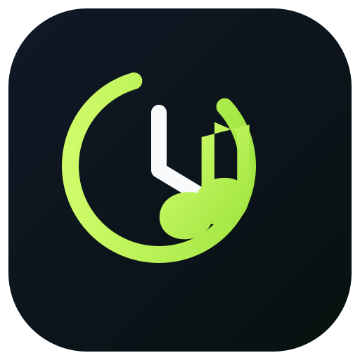
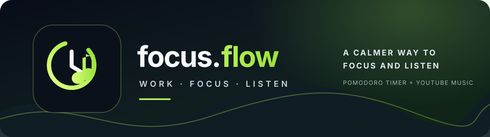

<p align="center">
  
</p>

<h1 align="center">Focus Flow</h1>

<p align="center"><strong>Pomodoro Timer · YouTube Music Search · Stay in the Flow</strong></p>

<p align="center">
  
</p>

<p align="center">
  <a href="https://pages.github.com/"></a>
  
  
  
  
</p>

<p align="center">
  <a href="#-features">Features</a> ·
  <a href="#-publish-the-website-on-github-pages">Deploy</a> ·
  <a href="#-run-the-website-locally">Run locally</a> ·
  <a href="#-youtube-api-setup">YouTube API</a>
</p>

Focus Flow is a browser-based productivity timer with customizable focus and break sessions, appearance settings, and a music panel for searching YouTube and playing selected tracks in YouTube's official player. Only tracks you choose to play are added to Recently Played; search results are not automatically saved to history.

**Live website:** After you enable GitHub Pages, replace the placeholders in this link with your GitHub username and repository name:

`https://YOUR-USERNAME.github.io/YOUR-REPOSITORY/`

> The live link will work only after the files have been pushed to GitHub and the Pages deployment has completed. This README cannot know your final URL until you choose a repository name.

## Features

- Pomodoro focus timer, short breaks, and long breaks
- Customizable timer durations and appearance
- YouTube search and playback through the official YouTube player
- Recently Played history for tracks you choose to play
- Browser-local storage for preferences and history
- Responsive layout for desktop and mobile browsers
- No build step or package installation required for the static website

## Project files

| File | Purpose |
| --- | --- |
| `index.html` | Website structure and controls |
| `styles.css` | Layout, colors, and responsive styling |
| `app.js` | Timer, settings, YouTube search/player, and browser storage logic |
| `README.md` | Setup, publishing, and troubleshooting guide |
| `404.html` | Simple not-found page for the site |
| `.nojekyll` | Prevents GitHub Pages from processing the site with Jekyll |
| `.gitignore` | Ignores common local/editor files |
| `LICENSE` | MIT license text |
| `assets/logo.svg` | Focus Flow brand logo |
| `favicon.svg` | Browser tab and bookmark icon |
| `assets/banner.svg` | Focus Flow banner displayed at the top of this README |

## 1. Publish the website on GitHub Pages

### A. Create a repository

1. Sign in to [GitHub](https://github.com/).
2. Open [Create a new repository](https://github.com/new).
3. Give it a name, for example `focus-flow`.
4. Choose **Public** if you want anyone to be able to view the repository, or choose another visibility option supported by your GitHub plan and Pages settings.
5. Create the repository. You can add a README there, but avoid replacing this project's README if you want to keep these instructions.

### B. Upload the project files

1. Download and extract the project ZIP to your computer.
2. Open the extracted `focus_flow_github_pages` folder.
3. In your GitHub repository, select **Add file → Upload files**.
4. Upload the *contents* of the extracted folder, not the ZIP file itself. Make sure `index.html`, `styles.css`, and `app.js` are directly in the repository root, alongside `README.md`.
5. Commit the upload to the `main` branch.

Your repository's root should look approximately like this:

```text
focus-flow/
├── index.html
├── styles.css
├── app.js
├── README.md
├── 404.html
├── .nojekyll
├── .gitignore
└── LICENSE
```

### C. Turn on GitHub Pages

1. Open your repository on GitHub.
2. Select **Settings → Pages**.
3. Under **Build and deployment**, set **Source** to **Deploy from a branch**.
4. Choose branch **`main`** and folder **`/(root)`**.
5. Click **Save**.
6. Wait for GitHub Pages to finish deploying. You can check progress in the repository's **Actions** tab or return to **Settings → Pages**.

### D. Open the live website

For a repository named `focus-flow`, the URL normally looks like:

`https://YOUR-USERNAME.github.io/focus-flow/`

For a repository named `YOUR-USERNAME.github.io`, the URL is normally:

`https://YOUR-USERNAME.github.io/`

Replace `YOUR-USERNAME` and the repository name with your own values. Open the URL in a browser. The website may take a few minutes to become available after the first deployment.

## 2. Run the website locally

This project is a static website. You do **not** need Node.js, `npm install`, or a backend to run the page itself.

### Option A — Python (recommended if installed)

1. Extract the ZIP.
2. Open a terminal or command prompt inside the folder that contains `index.html`.
3. Run:

   ```bash
   python -m http.server 8000
   ```

   If your system uses `python3`, run `python3 -m http.server 8000` instead.
4. Open `http://localhost:8000` in your browser.
5. To stop the local server, return to the terminal and press **Ctrl+C**.

### Option B — VS Code Live Server

1. Install [Visual Studio Code](https://code.visualstudio.com/).
2. Open the extracted project folder in VS Code.
3. Install the **Live Server** extension if it is not already installed.
4. Right-click `index.html` and choose **Open with Live Server**.
5. Your browser will open a local address, commonly `http://127.0.0.1:5500`.

You can also double-click `index.html` to view the page, but using a local HTTP server is recommended for consistent browser behavior.

## 3. Enable YouTube search

GitHub Pages serves static files only. It cannot run a Node.js server or keep a server-side `.env` file secret. This edition calls the YouTube Data API from the browser, so you need a YouTube Data API v3 key for search.

1. Open the [Google Cloud Console](https://console.cloud.google.com/).
2. Create or select a Google Cloud project.
3. Open **APIs & Services → Library**, search for **YouTube Data API v3**, and enable it.
4. Open **APIs & Services → Credentials** and create an API key.
5. In the key's settings, restrict it to **YouTube Data API v3**.
6. Add website referrers for the site where you will use the app. Examples (replace the placeholders):

   ```text
   https://YOUR-USERNAME.github.io/YOUR-REPOSITORY/*
   http://localhost:8000/*
   http://127.0.0.1:5500/*
   ```

   Add only the local address you actually use. If you use a different Live Server port, allow that port as well.
7. Open Focus Flow and expand **YouTube API setup** in the music panel.
8. Paste your API key and click **Save key**.
9. Search for a track and select it to play. A selected track should appear in Recently Played; search results alone should not be added.

### API key security

A key used by a browser cannot be kept secret from that browser's user. Restrict it by both API and HTTP referrer, keep an eye on quota usage, and do not commit an unrestricted key to GitHub. This project saves the key in the current browser's local storage; it does not require a `.env` file for GitHub Pages. For stronger protection, use a backend or serverless API proxy hosted separately from GitHub Pages.

## 4. Troubleshooting

### The page appears unstyled

- Confirm `styles.css` is in the same repository folder as `index.html`.
- Check the filename spelling and capitalization. GitHub Pages paths are case-sensitive.
- Open browser developer tools and look in **Console** and **Network** for failed file requests.
- Hard-refresh the page after deployment (`Ctrl+Shift+R` on many desktop browsers).

### Buttons or timer do not work

- Confirm `app.js` is beside `index.html` in the repository root.
- Check the browser developer tools **Console** for JavaScript errors.
- Hard-refresh the page after the latest commit has deployed.

### YouTube search fails

- Confirm the YouTube Data API v3 is enabled for the Google Cloud project that owns the key.
- Check that the key is saved in the app's **YouTube API setup** section.
- Check API restrictions, HTTP referrer rules, and remaining quota.
- Make sure the referrer pattern matches the exact deployed repository URL or local server address.

### Music does not play

- YouTube playback uses YouTube's official embedded player and is subject to YouTube availability, browser autoplay restrictions, and the video's playback settings.
- Try pressing Play after selecting a result and make sure your browser is not blocking playback.
- Some videos may be unavailable in your region or may not permit embedded playback.

## Playback note

YouTube's supported player displays video content. YouTube does not offer an official audio-only playback API. This project does not extract, download, or conceal YouTube's video stream.

## Privacy and saved data

Timer preferences, appearance settings, the API key, and Recently Played history are saved in the current browser using local storage. They are not automatically synchronized between devices. Clearing the site's browser storage removes the saved data.

## License

This project is distributed under the MIT License. See [`LICENSE`](LICENSE).
