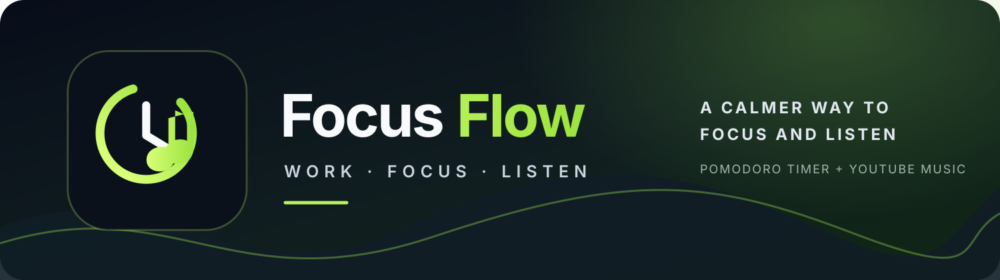

<p align="center">
  
</p>

<h1 align="center">focus.flow</h1>

<p align="center"><strong>Work · Focus · Listen — Minimal Pomodoro Focus Timer & Ambient Music Player</strong></p>

<p align="center">
  
</p>

<p align="center">
  <a href="https://pages.github.com/"></a>
  
  
  
  
</p>

<p align="center">
  <a href="#-features">Features</a> ·
  <a href="#-project-file-structure">Project Structure</a> ·
  <a href="#-local-development">Local Development</a> ·
  <a href="#-publish-to-github-pages">GitHub Pages</a> ·
  <a href="#-youtube-music-setup">YouTube Music Setup</a> ·
  <a href="#-troubleshooting">Troubleshooting</a>
</p>

---

**focus.flow** is an elegant, distraction-free Pomodoro productivity timer designed to help you stay in your flow state. It integrates a compliant, compact YouTube music player, customizable workspaces, ambient presets, and browser persistence without requiring complex backend servers or bloated frameworks.

---

## ⚡ Features

- **Pomodoro Focus Timer**: Configurable focus sessions, short breaks, and long breaks with session tracking and progress rings.
- **Accurate Background Execution**: Calculates remaining session time from actual timestamps so switching tabs or minimizing the browser won't desync your timer.
- **Audio Chime & Notifications**: Web Audio API synthetic chime that works offline without external sound files, plus optional browser desktop notifications.
- **Official YouTube Music Player**: Search YouTube videos, paste direct YouTube links or IDs, or select from curated focus stations (Lofi Beats, Synthwave, Deep Focus, Piano Flow).
- **Compliant Audio & Video Playback**: Fully compliant YouTube embedded player with pause, play, volume, previous, and next controls.
- **Strict History Hygiene**: Search results are **never** automatically added to history; only tracks you deliberately select for playback are recorded into Recently Played.
- **Appearance & Typography**: Custom accent colors, dark/light text, font sizes (Compact, Standard, Large), clean system/editorial/monospace/rounded typefaces, and Google Fonts or custom `.woff2` font loading.
- **Custom Workspaces & Media Backgrounds**:
  - Default deep midnight gradient
  - Custom colors and multi-stop angle gradients
  - Uploaded image or video files (stays local in browser memory)
  - Direct media URLs (.mp4, .webm, images)
  - Website embeds (via iframe)
  - Curated library of 8 gradient presets and 6 high-definition nature presets
  - Adjustable background darkness overlay (0–85%) and blur (0–20px)
- **Settings Backup**: Export and import your configuration as a clean JSON file anytime.
- **Quick Keyboard Shortcuts**:
  - `Space`: Start / Pause timer
  - `R`: Reset current session
  - `F`: Toggle fullscreen
  - `S` or `Esc`: Open / Close settings panel
  - `M`: Open / Close music panel
  - `N`: Skip to next session
  - `1`: Switch to Focus mode (25m default)
  - `2`: Switch to Short break (5m default)
  - `3`: Switch to Long break (15m default)
- **Smooth Loading Experience**: Center-aligned branding and rotating accent ring with automatic motion-reduction compliance (`prefers-reduced-motion`).

---

## 📁 Project File Structure

```text
focus.flow/
├── index.html          # Application structure, controls, and accessibility tags
├── styles.css          # Design system, themes, loading screen, and responsive layouts
├── app.js              # Timer engine, music integration, and local storage state
├── favicon.svg         # Primary application logo and browser icon
├── banner.svg          # Brand banner illustration
├── assets/
│   ├── logo.svg        # Scalable vector logo for brand presentation
│   ├── banner.svg      # High-resolution brand banner
│   └── favicon.svg     # Secondary asset reference for favicon
├── metadata.json       # Applet metadata configuration
├── package.json        # NPM dependencies and local dev scripts
├── 404.html            # Custom not-found page with matching aesthetic
├── .nojekyll           # Ensures GitHub Pages processes all assets without Jekyll
├── .gitignore          # Ignores editor and system artifacts
├── LICENSE             # MIT license
└── README.md           # Documentation and setup instructions
```

---

## 💻 Local Development

### Prerequisites
- Node.js (version 18 or newer recommended)
- A modern web browser (Chrome, Firefox, Safari, Edge)

### Setup & Run
1. Clone or download this repository.
2. Open a terminal in the project directory:
   ```bash
   npm install
   ```
3. Start the development server:
   ```bash
   npm run dev
   ```
4. Open [http://localhost:3000](http://localhost:3000) in your browser.

> **Tip**: Because this application is written in clean, modern vanilla JavaScript and HTML5, you can also serve it with any static web server (such as Python's `python3 -m http.server 3000` or VS Code Live Server).

---

## 🚀 Publish to GitHub Pages

Because **focus.flow** uses client-side architecture and official YouTube embed APIs, it can be hosted 100% free on **GitHub Pages**!

### Step 1: Create a GitHub Repository
1. Go to [GitHub](https://github.com/) and click **New Repository**.
2. Name the repository `focus.flow` (or any name you prefer).
3. Set the visibility to **Public** (or Private if you have GitHub Pro/Enterprise with Pages enabled).
4. Click **Create repository**.

### Step 2: Push or Upload Files
Ensure all project files (`index.html`, `styles.css`, `app.js`, `favicon.svg`, `banner.svg`, `assets/`, etc.) are placed in the **root** directory of your repository.

If using git:
```bash
git init
git add .
git commit -m "Initial commit for focus.flow"
git branch -M main
git remote add origin https://github.com/YOUR-USERNAME/YOUR-REPOSITORY.git
git push -u origin main
```

### Step 3: Turn on GitHub Pages
1. In your GitHub repository, navigate to **Settings** → **Pages**.
2. Under **Build and deployment**:
   - **Source**: Select `Deploy from a branch`
   - **Branch**: Select `main` and `/ (root)`
3. Click **Save**.
4. In 1–2 minutes, your website will be live at:
   ```
   https://YOUR-USERNAME.github.io/YOUR-REPOSITORY/
   ```

---

## 🎵 YouTube Music Setup

**focus.flow** gives you multiple ways to listen to music while you focus:

### 1. Curated Focus Stations (No API Key Required)
Click any of the curated station chips inside the music panel (e.g., *☕ Lofi Beats*, *⚡ Synthwave*, *🌌 Deep Focus*, *🎹 Piano Flow*). These stream instantly through YouTube's official player.

### 2. Direct YouTube Links or Video IDs (No API Key Required)
Copy any YouTube link from your browser (e.g. `https://www.youtube.com/watch?v=VIDEO_ID` or `https://youtu.be/VIDEO_ID`) and paste it directly into the search bar. **focus.flow** will immediately load the video into your player and save it to your Recently Played list.

### 3. YouTube Data API v3 (For Unlimited Live Search)
To search any song, artist, or album directly from within the app:
1. Open the [Google Cloud Console](https://console.cloud.google.com/).
2. Create a free project or select an existing one.
3. Search for **YouTube Data API v3** in the API Library and click **Enable**.
4. Navigate to **APIs & Services** → **Credentials** → **Create Credentials** → **API key**.
5. *(Recommended)* Under **API restrictions**, select **Restrict key** and check **YouTube Data API v3**. Under **Application restrictions**, add your GitHub Pages URL as an HTTP referrer.
6. In **focus.flow**, click the floating Music icon (`♫`), expand **YouTube API setup**, paste your key, and click **Save key**.
7. Your key is stored securely in your browser's `localStorage` and is never sent to any third-party server.

---

## 🛠️ Troubleshooting

- **Audio doesn't play automatically**: Modern browsers require user interaction (a click or key press) before allowing audio playback. Click the Play button or anywhere on the page to enable sound.
- **YouTube video says "Video unavailable"**: Some uploaders restrict embedding on third-party domains. Try another search result or a curated station.
- **Website background doesn't appear**: Many websites (like google.com or github.com) send `X-Frame-Options: SAMEORIGIN` or CSP headers that prevent them from being embedded in an iframe. Use sites that permit embedding or stick to image/video backgrounds.
- **Custom font doesn't load**: Ensure your URL is a direct `.woff2` font file or a valid Google Fonts CSS link that allows cross-origin requests (`Access-Control-Allow-Origin: *`).

---

## 📄 License

This project is licensed under the [MIT License](LICENSE).
